# 📊 Awesome Database Query & Reporting Tools

> 🚀 A curated directory of leading **Database Query & Reporting Tools**, **SQL Editors**, **Business Intelligence (BI) Dashboards**, and **Self-Service Analytics Platforms**.

Discover and compare top SaaS platforms and open-source database query tools, SQL IDEs, and BI reporting software designed for data analysts, database administrators, and software engineers.

---

## 📑 Table of Contents

- [🌐 Sector Overview & Market Dynamics](#-sector-overview--market-dynamics)
- [☁️ SaaS & Hosted Platforms](#️-saas--hosted-platforms)
- [🐙 Open-Source GitHub Projects](#-open-source-github-projects)
- [🏛️ Key Architectural Distinctions](#️-key-architectural-distinctions)
- [🤝 How to Contribute](#-how-to-contribute)
- [💖 Support & Sponsorship](#-support--sponsorship)
- [⭐ Star History](#-star-history)
- [📜 License & Disclaimer](#-license--disclaimer)

---

## 🌐 Sector Overview & Market Dynamics

The global business intelligence and reporting software market is estimated at **$41 billion to $44 billion** and is projected to surpass **$65+ billion** by 2030, expanding at a CAGR of ~9%. The sector exhibits **moderate fragmentation**: while mega-cap cloud providers (Microsoft Power BI, Salesforce Tableau, Google Cloud Looker) anchor large-scale enterprise deployments, substantial market share is contested by specialized, high-growth modern data stack (MDS) vendors and agile open-source platforms focusing on code-first BI, dbt-native semantic modeling, and collaborative SQL IDEs.

---

## ☁️ SaaS & Hosted Platforms

A comprehensive comparison of top commercial SaaS database querying, reporting, and BI tools. Platforms are ranked by parent company size, enterprise valuation, or annual revenue in descending order.

| 🏢 Product | 📈 Company Scale (Revenue / Valuation) | 📝 Description | 💳 Starting Pricing Tier | 🎁 Free Tier & Trial Limits |
|:---|:---|:---|:---|:---|
| **[Looker (Google Cloud)](https://looker.com/)** | **~$2.2T** market cap (Alphabet parent); acquired Looker for **$2.6B**; Looker platform ARR estimated at $500M+ | Enterprise-grade semantic data platform and BI suite built on LookML data modeling with governed metrics. | **$5,000 / month** (Standard Platform, billed annually at ~$60,000/yr; includes 10 Standard + 2 Developer users) | **No permanent free plan**; 30-day guided enterprise proof-of-concept trial via Google Cloud sales |
| **[Zoho Analytics](https://www.zoho.com/analytics/)** | **~$12B - $12.5B** valuation; **~$1.4B** FY25 ARR (bootstrapped & profitable) | Cloud BI and self-service analytics suite featuring Zia AI assistant, 100+ connectors, and embedded portals. | **$24 / month** (Basic plan billed annually, or $30/mo billed monthly; includes 2 users and 500,000 rows) | **Permanent Free Tier**: 2 users, 2 workspaces, 10,000 rows limit; **15-day free trial** for premium tiers (no credit card required) |
| **[Mode Analytics](https://mode.com/)** | **$4.2B** valuation (parent ThoughtSpot; acquired Mode for **$200M**; combined ARR exceeds $150M) | Collaborative data platform uniting SQL editor, interactive Python/R notebooks, and visual reporting for data teams. | **$35 / user / month** (Business plan, min team commitment ~$10,500/year) | **Free Community Plan**: 1 user, unlimited personal queries/notebooks; **14-day free trial** of Business plan with full collaboration features |
| **[Hex](https://hex.tech/)** | **$1.2B** valuation (Series D in Oct 2026; $272M total funding; $10M–$50M estimated ARR) | Modern collaborative data workspace integrating SQL, Python, drag-and-drop visualizations, and agentic AI. | **$36 / editor / month** (Professional plan; viewers are always free) | **Permanent Community Plan (Free)**: 1 editor, 3 active projects, unlimited viewers, standard compute; **14-day free trial** for Teams tier |
| **[PopSQL](https://popsql.com/)** | Acquired by Timescale ($18.5M prior funding; parent Timescale raised $180M+; estimated ARR $5M–$10M) | Collaborative SQL editor and query workspace with automatic schema visualization, git integration, and team shared folders. | **$19 / editor / month** (Premium plan; viewers are completely free) | **Permanent Free Tier**: 1 editor, unlimited free viewers, max 2 database connections, 10 saved queries, 2 dashboards, 1-day version history |
| **[Holistics](https://www.holistics.io/)** | **$4M - $5M** ARR (bootstrapped / independent; ~50 employees) | Analytics-as-code BI platform utilizing a reusable modeling layer (AML) for governed self-service reporting. | **$210 / month** (SGD 210/mo for Entry tier; includes 100 data objects and 10 users) | **No permanent free plan**; **14-day free trial** with full platform capabilities, 5 database connections, and sample datasets |

---

## 🐙 Open-Source GitHub Projects

Leading open-source database query workbenches, SQL editors, headless semantic layers, and self-hosted BI dashboards. Sorted by GitHub_Stars in descending order.

| 📦 Project | ⭐ GitHub_Stars | 📝 Description | ⚙️ Core Capabilities |
|:---|:---:|:---|:---|
| **[Apache Superset](https://github.com/apache/superset)** |  | Modern enterprise-grade business intelligence, SQL exploration, and data visualization web application. | 40+ visualization types, petabyte-scale SQL IDE, semantic dataset metrics, granular role-based security (RBAC). |
| **[NocoDB](https://github.com/nocodb/nocodb)** |  | Open-source smart spreadsheet alternative to Airtable that connects directly to relational databases. | Converts PostgreSQL, MySQL, SQL Server, and SQLite into interactive grid, gallery, kanban, and form views with REST APIs. |
| **[DBeaver Community](https://github.com/dbeaver/dbeaver)** |  | Universal desktop database management tool and SQL client for developers, DBAs, and analysts. | Supports 100+ JDBC drivers (PostgreSQL, MySQL, SQLite, Oracle, ClickHouse, DuckDB); includes visual ER diagrams and SQL autocomplete. |
| **[Metabase](https://github.com/metabase/metabase)** |  | The simplest, most intuitive self-hosted BI dashboard and visual query builder for non-technical users. | **Genuinely free open-source edition** with unlimited users and dashboards, visual query drill-throughs, SQL editor, and email alerts. |
| **[Directus](https://github.com/directus/directus)** |  | Real-time modular data platform that layers an administrative dashboard and data studio over SQL databases. | Instant visual query dashboards, no-code data studio, granular RBAC, automatic GraphQL and REST API generation. |
| **[Redash](https://github.com/getredash/redash)** |  | SQL-first data visualization and sharing platform connecting directly to databases and query engines. | Query editor with autocomplete and snippets, 30+ supported data connectors, scheduled dashboard refreshes, query result caching. |
| **[Beekeeper Studio](https://github.com/beekeeper-studio/beekeeper-studio)** |  | Modern, clean, and lightweight cross-platform SQL editor and database manager built with Vue and Electron. | Clean tabbed SQL editor, schema browser, SSL/SSH tunnel encryption, data table editor for PostgreSQL, MySQL, SQLite, SQL Server, CockroachDB. |
| **[Cube](https://github.com/cube-js/cube)** |  | Universal semantic layer and headless data modeling engine for modern data applications and BI tools. | Pre-aggregation caching engine, code-based data modeling, access control, and SQL/REST/GraphQL API endpoints. |
| **[Grist](https://github.com/gristlabs/grist-core)** |  | Relational spreadsheet-database hybrid combining spreadsheet flexibility with real database relational integrity. | Python formula evaluation, custom interactive dashboard layouts, access rules down to column/row level, offline-ready. |
| **[Evidence](https://github.com/evidence-dev/evidence)** |  | Code-first BI reporting framework delivering interactive data products generated via Markdown and SQL. | Version control via Git, fast static build generation, DuckDB in-browser execution, parameterized automated reports. |
| **[Lightdash](https://github.com/lightdash/lightdash)** |  | Open-source Looker alternative built natively on top of dbt core for version-controlled metric definitions. | Reads dbt project models and YAML directly, self-service charting for business users, Git pull-request previews for metrics. |
| **[SQLPad](https://github.com/sqlpad/sqlpad)** |  | Lightweight web-based SQL editor and simple chart builder designed for internal team queries. | Docker-first deployment, connection management, query sharing via URL, support for Postgres, MySQL, SQL Server, ClickHouse, Snowflake. |
| **[Rill](https://github.com/rilldata/rill)** |  | Fast, operational BI and dashboard tool pairing DuckDB/ClickHouse with opinionated metrics exploratory UX. | Sub-second interactive dashboards, local-first developer experience, code-driven dashboard definitions in YAML and SQL. |

---

## 🏛️ Key Architectural Distinctions

When selecting a database query and reporting tool, consider these fundamental paradigms:

1. **🛠️ SQL Workbenches vs. Business Dashboards**: Tools like **DBeaver** and **Beekeeper Studio** are developer/DBA-focused clients for table management, indexing, and raw DDL/DQL execution. In contrast, **Metabase**, **Apache Superset**, and **Lightdash** are built for cross-functional reporting with non-technical business consumers.
2. **🧱 Semantic-Layered BI vs. Direct SQL BI**: **Looker** and **Cube** separate metric definition from data presentation through reusable modeling code (LookML, Cube data models, or dbt metrics in **Lightdash**). Direct SQL tools (**Redash**, **Evidence**) run queries directly against analytical warehouses (Snowflake, BigQuery, ClickHouse).
3. **📊 Database-Spreadsheet Hybrids**: Platforms like **NocoDB** and **Grist** provide spreadsheet-like interfaces on top of relational engines, enabling operational record editing alongside custom visual reports.

---

## 🤝 How to Contribute

Contributions are warmly welcome! Please follow these steps:

1. 🍴 Fork this repository.
2. 🔍 Ensure new SaaS additions include transparent pricing and specific free-tier/trial terms.
3. ⭐ Ensure open-source additions include active GitHub repositories with valid social Stars_Badges.
4. 📋 Keep entries categorized, objective, and alphabetical or star-ranked.
5. 🚀 Submit a pull request detailing your suggested changes.

---

## 💖 Support & Sponsorship

Thank you for visiting and using this curated resource! If you find this repository valuable:

- ⭐ **Star** this repository to show your appreciation and help others discover it.
- 🍴 **Fork** it to keep your own curated reference or build your own enhancements.
- 📢 **Share** it with your fellow engineers, data teams, and analytics communities.
- ☕ **Buy me a coffee**: If you'd like to support ongoing curation and open-source projects, you can sponsor through the [GitHub Sponsors Dashboard](https://github.com/sponsors/ishandutta2007).

Your support is deeply appreciated! 🙌

---

## ⭐ Star History

---

## 📜 License & Disclaimer

- 📖 Curated by the community under the [MIT License](LICENSE) for informational and evaluation purposes.
- ⚖️ All trademarks, product logos, and registered brand names belong to their respective corporate owners.
